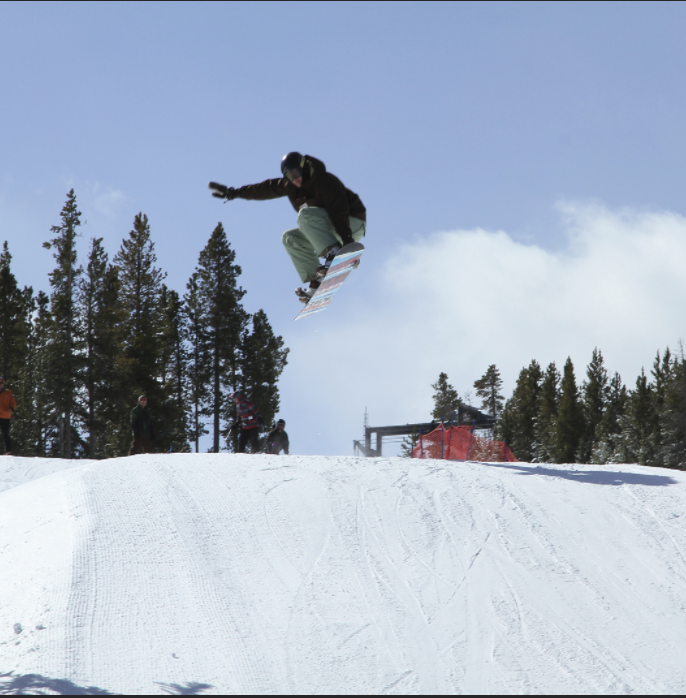

## Jason Horner

*Data Platform Consultant, Trainer, and Speaker*

Hi, I'm Jason! I'm an independent consultant, trainer, and speaker, and the founder of [Empty Cup Consulting](https://emptycupconsulting.com/).

I help organizations solve real business problems with data and technology. My work spans SQL Server, Microsoft Fabric, Azure, modern data engineering, analytics architecture, and AI.

Sometimes that means designing a modern data platform. Other times, it's untangling a troublesome data pipeline, improving data quality, or helping a team decide what to build next. I enjoy the complicated problems, especially when solving them makes life easier for the people who have to operate the solution.

I've been doing this long enough to have collected a few letters after my name. I'm a **Microsoft Certified Master (MCM) in SQL Server**, hold the **Microsoft Fabric Analytics Engineer Associate (DP-600)** and **Fabric Data Engineer Associate (DP-700)** certifications, and am a former six-year **Microsoft Most Valuable Professional (MVP)**.

When I'm not working, you'll probably find me snowboarding, singing karaoke, riding roller coasters, or playing arcade games. Sometimes all four, though usually not at the same time.

## I Can Talk Nerdy For You

I enjoy speaking at conferences, user groups, and community events about data engineering, architecture, analytics, and the technologies that make it all work.

Interested in having me speak at your event? [See my Speaking page](/speaking/).

## Papa Needs Brand New Shoes

I'm always interested in meaningful, challenging work—and occasionally something that sounds a little crazy.

[Learn more about consulting](/consulting/).
